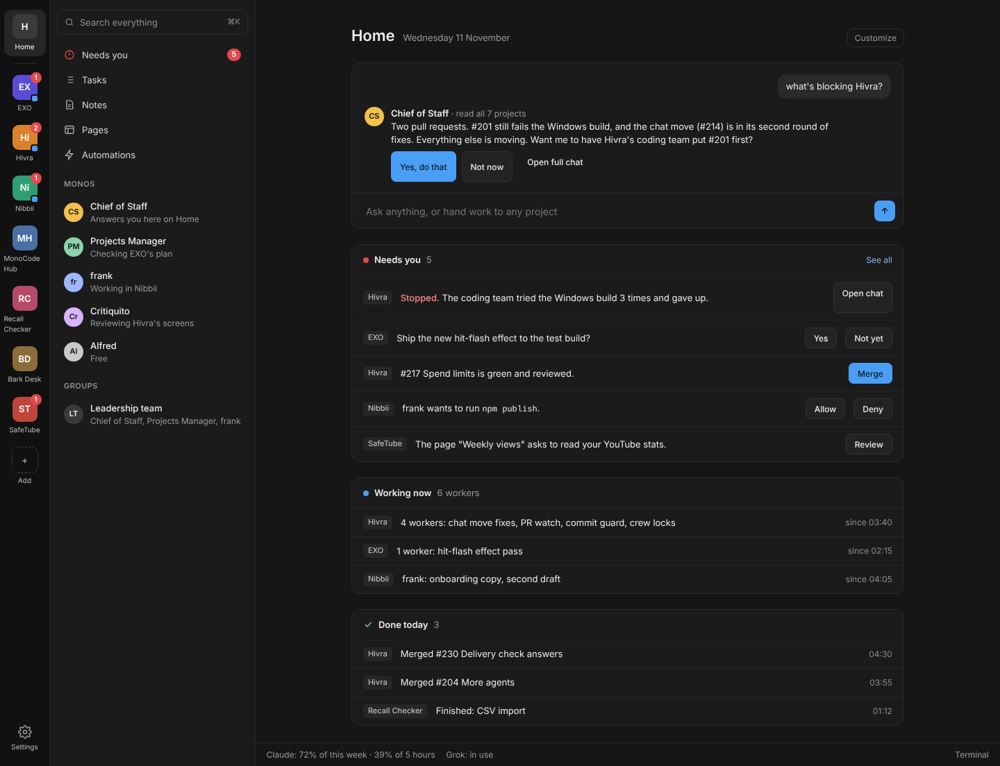

# Hivra's screens: the one model

Every screen follows this from 11 Nov 2026. Packages WP-210 to WP-214 (Wave N in [PLAN.md](PLAN.md)) build it. A UI
change that doesn't fit this model is reviewed against it and sent back.

**Why:** Ash, 11 Nov, looking at 0.16.15's Home: "visually nothing makes sense", and "home doesn't even work ...
right now there is no ux at all". Each package added its own corner of the screen, and nobody owned the whole. The
result was a Home that said "All quiet." under a red Needs you, three ways into the same coding team, an Inbox that
showed someone else's GitHub repo, a Home chat box that filed questions as tasks, and counts that disagreed.

Mockups, with example data: [ux/mockups/](ux/mockups/) (`Main.png` Home, `Project.png` a project, `NeedsYou.png`,
`Model.png` this page in one picture; the `.html` files open in any browser).

## Three places

| Place | What it is | What it is not |
| --- | --- | --- |
| **Home** | Everything across projects. The Chief of Staff's chat at the top (ask anything, hand work to any project), then Needs you, Working now and Done today. | Not a list of projects (the rail is that list). Not a dashboard of counters. |
| **A project** | Its coding team chat is its home screen. The sidebar holds its Tasks, Pages, Monos and chats. A header shows its counts and the Autopilot switch. The Crew panel on the right shows each worker, its pull request and its checks. | Not three entries ("Hivra lead", "Coding team", the project row) into one screen. |
| **Settings** | Only settings, in about twelve groups. | Not a home for things you look at (activity, usage, past decisions): those move to where you'd look for them. |

The rail (the strip on the far left) holds places only: **Home**, one tile per project, **+** to add a project, and
**Settings** at the bottom. A project tile carries a red count (its Needs you items) and a small blue dot while any of
its workers is running. Nothing else goes on the rail: Autopilot, Hub, Inbox and app sections leave it.

The sidebar follows the place. On Home: Search, Needs you (with the count), Tasks, Notes, Pages, Automations, then
Monos and Groups. In a project: the project's name and folder, Coding team (with "2 need you · 4 working" under it),
Tasks, Pages, Monos on this project, Chats, Groups.

## One list: Needs you

Stopped workers, questions, approvals, failed Leads, gate and delivery checks, work ready to merge, and review requests
on Ash's own repos all go into **one list**, built in one place (WP-210). Every number on screen counts that list:

- the red count on a project's rail tile;
- the Needs you count in the Home sidebar and the Needs you section on Home;
- a project's header chip and its sidebar line;
- a Mono's red line in the sidebar;
- the Needs you screen (WP-211) and its filter chips.

So they always agree. Answering an item anywhere (the Needs you screen, Home, the chat it came from) removes it
everywhere at once. Nothing says "All quiet" while the list has anything in it. Before this, about twelve pieces of
code each decided "needs you" on their own (`todayCounts.attentionCount`, `waiting.waitingCount`, `inboxCountNote`,
`home/model/lines`, the Inbox dot, `needsYouRows` for workers only, and more), and that is why the screens contradicted
each other.

## One name for each thing

| Before | From now on |
| --- | --- |
| Inbox (a GitHub feed for someone else's repo) | **Needs you**. Review requests on Ash's own repos join it. |
| "Hivra lead", "Coding team" and the project row: three ways into one screen | **Coding team**: one entry, one screen |
| Dashboards, the Agents page, "Edit Today" | **Pages** |
| Waiting on you, Asking you, Waiting for you | **Needs you** |
| Being built, Moving now, jobs | **Working now** |
| MonoCode and MonoCode Hub in the app's own text | **Hivra** (the bundle and data folder change only with the rename, WP-07 step 2, last) |
| Raw ids (`chief-of-staff`), folder paths in place of project names | **Names**, always |

The wording rules Ash set in PM rounds r30, r30c and r57a still hold: never the word "Stuck"; a stopped worker is a red **Needs you** with one plain
reason and one button; waiting kinds are grey; no amber on the rail or sidebar.

## What goes away

- Autopilot and Hub tiles in the rail. Autopilot becomes a switch in each project's header; its log moves to Settings.
- The projects list on Home. The rail already is that list.
- Home's pretend chat that filed questions as tasks (`askChief` in `chief/model/answer.ts`). The real Chief of Staff
  Mono answers instead, and hands work to the right project's coding team.
- Loose "Move up", "Hide" and "Pin a panel" text on Home. One **Customize** button holds them.
- Badges counted from placeholder data (`hubBuilds`, `hubWork` and `proposals` mocks), Ash OS leftovers, the update row
  that has no update server, and upstream's GitHub star prompt.
- The Automations gallery of someone else's templates. It starts from Ash's projects and Monos instead.
- Emoji reactions that look like buttons, and usage lines repeated in three places. Usage lives once, in the status
  bar at the bottom.

This replaces WP-73 rule 6 ("no counters, badges or status chips"): there is now exactly one kind of count, the red
Needs you count from the one list, plus the "working" count beside it. Nothing else is counted.

## Rules for every screen

1. **Plain words a person would say.** A row reads as a sentence: "frank wants to run `npm publish`." Not ids, not
   paths, not field names.
2. **One action per row, maybe two.** The primary action is the blue button; the other is grey. A row never has more
   than three buttons.
3. **Every number comes from the one list or the working list.** A new count anywhere needs a new kind in WP-210's
   list, not its own query.
4. **Empty means hidden.** A section with nothing in it doesn't show. Home with nothing at all shows the Chief of
   Staff's chat and one line: "Nothing needs you."
5. **Example data in tests says so.** Seeded rows in specs start with "Example:" as today, so a screenshot can't be
   mistaken for Ash's real state.
6. **Dark theme first,** in the app's existing tokens; the mockups' greys and the red `#e5484d` / blue `#3b82f6`
   are the targets. No new colours without a reason in the PR.

## How a UI change is checked

A test passing is not the check; looking at it is. Every PR that changes something a person sees:

1. **Before and after screenshots at 1440 × 900** of each screen it changes, from a browser spec with seeded example
   data (`tests/browser/`, `page.screenshot`). These go in the PR. They hold example data only.
2. **The same screens in a dev copy** (`npm run hub:dev -- --seed`, a cleaned backup of Ash's chats). These hold Ash's
   real chats, so they **never go to GitHub** (the repo is public). They stay on the Mac under
   `~/Worktrees/ux-shots/<WP>/before|after/`, and the PR says where.
3. **The integrating Claude looks at both against the mockups and this page** before merging, and writes what it
   checked in the PR (screen by screen: matches, or what it sent back). Counts on every screen in one shot must
   agree with each other.
4. A screenshot that shows "All quiet" beside a red count, two names for one thing, a raw id, or a button that does
   nothing is a FAIL whatever the tests say.

## Order

1. **WP-210** One Needs-you list, first: everything else reads it.
2. **WP-212** Home, beside 210 (it reads the list through one hook, stubbed until 210 lands).
3. **WP-213** Rail, sidebar and the project screen.
4. **WP-211** The Needs you screen, after the open Inbox packages (#213 secret vault, #220 security review, #225
   standing answers) land, because they touch `FirstMateInboxPanel`.
5. **WP-214** Words and leftovers, last: it renames across everything the others built.
