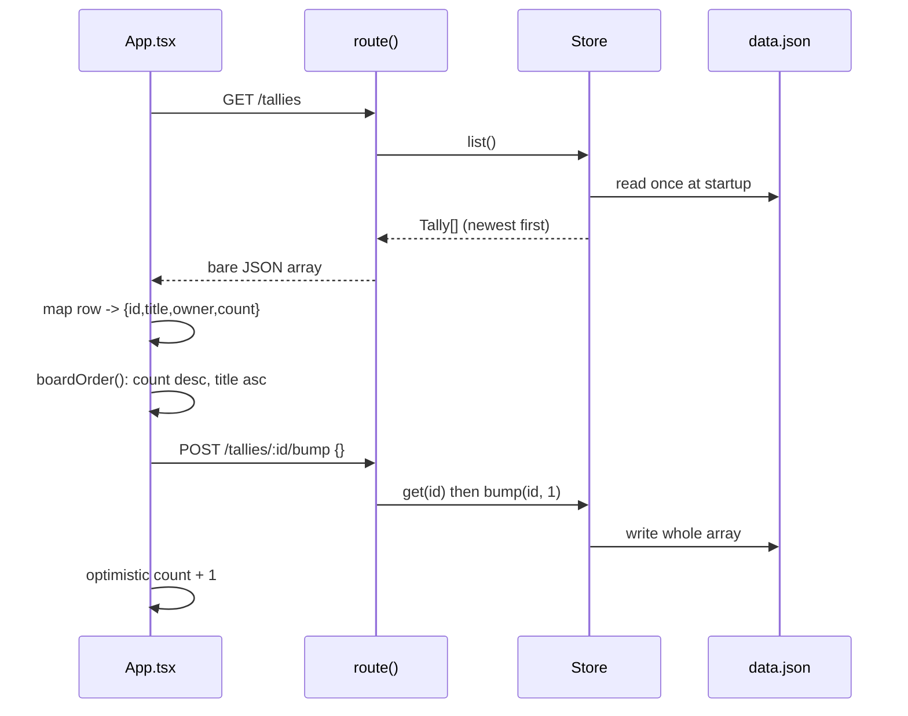

# Research: archiving a tally instead of deleting it

**Task:** `tally-archive` — “Make delete archive the tally instead… Keep the existing API shape working.”
**Repo:** `tally`, branch `main`, commit `bd8ef34` (clean working tree)
**Date:** 2026-11-05
**Scope:** all 19 tracked files were read; every source and test file is covered below.

## The delete the task describes does not exist yet

The task begins “Today `DELETE /tallies/:id` removes a tally for good,” but there is no delete route in the codebase. `route()` only recognizes `GET /tallies`, `POST /tallies`, `POST /tallies/:id/bump`, and `GET /tallies/:id/stats` (`packages/api/src/server.ts:24-41`). Every other method on an existing tally falls through to the same `405 method not allowed` branch (`packages/api/src/server.ts:42`). `DELETE /tallies/:id` is item 2 in the backlog, still undone (`TODO.md:4`), and it is absent from the README’s endpoint table (`README.md:22-27`).

A direct probe of `route()` confirms the behavior:

```text
POST /tallies              => 201 {"id":"4fea78b6","name":"water",...}
DELETE /tallies/4fea78b6   => {"status":405,"body":{"error":"method not allowed"}}
GET /tallies/4fea78b6      => {"status":405,"body":{"error":"method not allowed"}}
DELETE /tallies/nope       => {"status":404,"body":{"error":"no such tally"}}
DELETE /tallies            => {"status":404,"body":{"error":"no such tally"}}
GET /tallies after delete  => still contains the tally
```

Two ordering facts explain the last two lines. The URL is split into segments and the first segment must be `tallies` (`server.ts:21-22`), then the tally is looked up **before** the method is dispatched (`server.ts:34-35`), so an unknown id is a 404 for every method, while a missing id makes `DELETE /tallies` a 404 too. The full current route matrix:

| Request | Today’s result | Code |
| --- | --- | --- |
| `GET /tallies` | 200, bare JSON array of tallies, newest first | `server.ts:24` |
| `POST /tallies` | 201 Tally, or 400 for bad name/owner | `server.ts:25-32` |
| `POST /tallies/:id/bump` | 200 updated Tally; 400 bad `by`; 404 unknown id | `server.ts:34-40` |
| `GET /tallies/:id/stats` | 200 Stats; 404 unknown id | `server.ts:34-35,41` |
| `GET /tallies/:id` | 405 method not allowed | `server.ts:42` |
| `DELETE /tallies/:id` (known id) | 405 method not allowed | `server.ts:42` |
| `DELETE /tallies/:id` (unknown id) | 404 no such tally | `server.ts:34-35` |
| `DELETE /tallies` | 404 no such tally | `server.ts:34-35` |
| Any other path | 404 not found | `server.ts:22` |

So the archive feature is not changing an existing delete implementation; it is introducing delete semantics for the first time. There is no prior response code, response body, or UI delete flow to preserve. “Keep the existing API shape working” can only refer to the four routes that do exist and their current bare-object/bare-array responses described below.

## All requests funnel through one exported `route()` function

The HTTP layer is deliberately thin. `createServer()` builds a `node:http` server, parses a JSON body only when the method is `POST` (`server.ts:47`), and hands everything to `route(store, method, url, body)` (`server.ts:48-51`). A malformed JSON body becomes a 400 before routing (`server.ts:9-18,49-50`). Every successful response is `application/json`; there is no envelope, so a list is a bare array and a single tally is a bare object (`server.ts:52-54`).

```text
createServer (server.ts:45)
  readJson(req)                      only when method === "POST" (server.ts:47)
  route(store, method, url, body)    (server.ts:20)
    split path on "?" and "/"        query strings are discarded (server.ts:21)
    reject first segment !== "tallies"
    GET  /tallies                    -> store.list()
    POST /tallies                    -> checkName -> checkOwner -> store.create()
    store.get(parts[1])              every other /tallies/:id request (server.ts:34)
    POST .../bump                    -> checkBump -> store.bump()
    GET  .../stats                   -> stats(tally.entries)
    everything else                  -> 405
```

Because `route()` is exported and independent of the HTTP server (`server.ts:20,45`), the tests drive it directly with a fake method, URL, and body. That is the established seam for adding new method behavior. `route()` also dispatches only on the third path segment (`bump`, `stats`) and ignores anything deeper; a `DELETE` implementation would be another branch in the same chain.

**How it is tested.** `packages/api/test/server.test.ts` calls `route()` directly, never `createServer()`. There is no test for the HTTP wrapper, header handling, malformed JSON, or method normalization. See “The test suite runs through `route()`” below.

## Tallies live in one in-memory array, rewritten to a JSON file after every change

`Store` owns a single `Tally[]` loaded once when the process starts (`store.ts:7-14`). If the file does not exist it starts empty; if it does, the file is parsed and cast to `Tally[]` with no validation or migration (`store.ts:13`). Every mutation mutates that array and then rewrites the entire file synchronously (`store.ts:24-29,31-37,39-41`).

```text
Store(file)
  constructor
    file exists ? JSON.parse(readFileSync(file)) as Tally[] : []
  list()
    return a copy sorted by createdAt descending
  get(id)
    return first tally whose id matches
  create(name, owner, now = new Date())
    push { id: randomUUID().slice(0, 8), name, owner,
           createdAt: now.toISOString(), entries: [] }
    save()
  bump(id, by, now = new Date())
    find tally by id; push { at: now.toISOString(), by }; save()
  save()
    writeFileSync(file, JSON.stringify(tallies, null, 2) + "\n")
```

Key structural facts for archive work:

- `list()` and `get()` are the **only** two read accessors (`store.ts:16-22`). There is no second collection, no index, and no query API. Anything archived would still live in the same array unless the code splits it.
- `list()` returns a sorted copy of the array, so filtering is a property of that one method; the objects inside are shared references.
- `get()` returns the first match and is used by the HTTP route before any sub-route dispatch (`server.ts:34`). Bump and stats both depend on it.
- `create()` and `bump()` accept an injectable `now`, but no current test uses that parameter.
- Persistence is whole-file and synchronous; the file is read only at construction, so external edits after startup are invisible.
- The file path comes from `TALLY_DATA`, defaulting to `./data.json` (`main.ts:5`), and `data.json` is gitignored (`.gitignore:2`).

**How it is tested.** There are no direct `Store` tests. The store is exercised indirectly through `route()` using a throwaway directory made with `mkdtempSync` (`server.test.ts:10-13`). No test inspects the JSON file’s contents, checks reload-after-write, or seeds a pre-existing file.

## The stored tally shape has five fields and no lifecycle state

Every package that needs the data model imports the shared types. `Tally` is exactly `{ id, name, owner, createdAt, entries }`, and `Entry` is `{ at, by }` (`packages/shared/src/types.ts:3-16`). There is no `archived`, `deletedAt`, `status`, or any other lifecycle field.

```ts
export type Tally = {
  id: string;
  name: string;
  owner: string;
  createdAt: string;
  entries: Entry[];
};
```

The shared package is imported by relative path rather than by package name — `server.ts:3-5` imports validators and `Store` from `../../shared/src/...`, and `store.ts:4` and `stats.ts:1` import types the same way. `import type` is used for types, which the Node type-stripping test runner erases (`package.json:8`).

There is no migration layer anywhere. `Store` casts parsed JSON straight to `Tally[]` (`store.ts:13`), so whatever fields existed when the file was written are all that exist at runtime. Files produced by `create()` contain exactly the five fields above, serialized with two-space indentation (`store.ts:25,40`). A tally loaded from an older file therefore has no archive marker of any kind. Any new marker has to tolerate `undefined` on existing rows or be backfilled when the file is loaded — the codebase currently does neither.

The UI does **not** use this shared type. `packages/ui/src/format.ts` defines its own `BoardTally = { id, title, owner, count }` (`format.ts:3-8`), and `App.tsx` maps API rows into that shape. The README lists this duplication as a known problem (`README.md:42`).

**How it is tested.** Type shapes are only checked transitively by whatever consumes them; there is no type-level test and no fixture representing an older data file. The shared package’s tests cover validation only.

## Visibility is decided entirely by `GET /tallies`, and the UI has no delete or archive path

The board is a single React component that runs one fetch on mount (`App.tsx:10-23`) and never refetches. It maps each API row to `BoardTally`, computing `count` as the sum of **all** entries in the tally — no week filtering happens anywhere (`App.tsx:13-21`). The rendered rows are sorted by count descending, ties by title (`format.ts:15-18`), which is a different order from the API list’s newest-first sort (`store.ts:16-18`).



Relevant to the archive requirement:

- “Disappears from the board” is not a UI behavior today. The board renders whatever `GET /tallies` returns and has no filter of its own. If the endpoint omits archived tallies, the board omits them; no UI change is needed for hiding.
- There is no delete button, no archived view, no restore control, and no routing/navigation in the UI (`App.tsx:30-42`). The only interactive element is `+1`.
- `weekLabel()` always prints `"N this week"` (`format.ts:10-13`) even though `count` sums every entry ever recorded; the weekly reset and last-week total from the README requirement (`README.md:29-32`) are not implemented.
- The empty `entries` array on a fresh tally produces `count: 0`.

**How it is tested.** Only the pure helpers are tested, in `packages/ui/test/format.test.ts`: the label text and the board ordering (`format.test.ts:6-20`). `App.tsx` is not tested at all; React is declared as a dependency but not installed, and the README says only the helpers are tested (`README.md:13,15-18`).

## Per-tally stats are computed from entries in memory; there is no aggregate stats surface

`stats(entries)` is a pure function over one tally’s entries (`stats.ts:20-30`). `dailyTotals()` groups entries by the UTC date prefix of `at` (`entry.at.slice(0, 10)`), sums each day’s `by` values, and returns the daily totals oldest first (`stats.ts:4-11`). `stats()` then derives total, number of active days, mean of daily totals, median, and best day, returning zeroes for an empty list (`stats.ts:20-30`).

```text
dailyTotals(entries)
  map UTC day -> sum of by
  return sums sorted by day ascending

stats(entries)
  days = dailyTotals(entries)
  total = sum(days)
  days = length(days)
  mean = total / days, or 0
  median = sorted(days)[floor(length / 2)], or 0
  best = max(days), or 0
```

The HTTP endpoint fetches the tally through `store.get(id)` and passes `tally.entries` straight to `stats()` (`server.ts:34,41`). The store is not consulted for archival state, and there is no team-wide or cross-tally aggregation anywhere in the codebase. That makes the task sentence “Stats should ignore archived tallies” underdetermined by the current code: the only stats surface is `/tallies/:id/stats`, which either resolves a tally or returns 404. Whether an archived tally’s stats should 404, keep returning numbers, or be reachable through some other rule is a decision the code does not make.

The stats suite is also the pre-existing red test. `median([1, 2, 3, 10])` is expected to be `2.5` by `stats.test.ts:16-18`, but the implementation returns `sorted[Math.floor(4 / 2)]`, i.e. the upper middle `3` (`stats.ts:17`). Running `npm test` confirms the baseline: **12 tests, 11 pass, 1 fail**. The README calls this out as a known problem (`README.md:41`), and it is backlog item 1 (`TODO.md:3`).

**How it is tested.** `packages/api/test/stats.test.ts` is a pure unit suite: grouping by day, median with odd and even counts, and a combined week. It does not test the `/tallies/:id/stats` route, empty entries, timezone boundaries, or archived tallies. The route-level stats path is only touched by the unknown-id 404 test (`server.test.ts:32-34`).

## The test suite drives `route()` and pure helpers, never HTTP or React

The root script runs every package’s test file with Node’s built-in runner and type stripping: `node --experimental-strip-types --no-warnings --test packages/*/test/*.test.ts` (`package.json:8`). There are four test files, all using `node:test` and `node:assert/strict`, with no third-party framework, no mocking library, and no fixture files.

| Test file | Level | Covers | Does not cover |
| --- | --- | --- | --- |
| `packages/api/test/server.test.ts` | Route-level integration with a real temp-file `Store` | create + bump + list happy path (`:15-24`), invalid name/owner 400 (`:26-30`), unknown tally 404 (`:32-34`) | HTTP server, DELETE/restore, list filtering, persistence contents |
| `packages/api/test/stats.test.ts` | Pure unit | daily grouping (`:8-10`), median odd/even (`:12-18`), combined stats (`:20-23`) | The stats route, empty input, archived tallies |
| `packages/shared/test/validate.test.ts` | Pure unit | `checkName`, `checkOwner`, `checkBump` (`:6-22`) | Stored-data validation (none exists) |
| `packages/ui/test/format.test.ts` | Pure unit | `weekLabel`, `boardOrder` (`:6-20`) | `App.tsx` entirely |

The established fixture pattern is `freshStore()`: create a unique temp directory with `fs.mkdtempSync(path.join(os.tmpdir(), "tally-"))` and construct a `Store` against `data.json` inside it (`server.test.ts:10-13`). Each test gets an isolated store and no cleanup is performed. Route tests call `route(store, method, url, body)` and assert on `{ status, body }` (`server.test.ts:15-34`).

Consequently, a delete/archive test has an obvious existing seam: call `route()` with method `"DELETE"` and assert the status and the subsequent `GET /tallies`. Restore tests would need the same direct-route style, plus some way to observe archived tallies because no read surface for them exists today. There is no test that exercises `createServer` (`server.ts:45-55`), so HTTP-only concerns such as body parsing on non-POST methods are untested.

The suite is red before any change because of the even-count median test described above; any verification that “stats ignore archived tallies” starts from a failing baseline.

## Code references

**Entry points and configuration**

- `package.json:7-10` — workspace scripts: `npm test` (all packages, type stripping) and `npm run api`.
- `packages/api/src/main.ts:4-6` — reads `PORT` (default 4317), creates `Store` from `TALLY_DATA` (default `./data.json`), starts the server.
- `.gitignore:1-2` — ignores `node_modules/` and `data.json`.

**HTTP and routing** — exhaustive for this area

- `packages/api/src/server.ts:9-18` — `readJson`: accumulates the request body, `{}` when empty, `null` on invalid JSON.
- `packages/api/src/server.ts:20-43` — `route`: path splitting, only `/tallies` accepted, list/create, id lookup, bump, stats, 405 fallback.
- `packages/api/src/server.ts:34-35` — id lookup happens before method dispatch; drives 404-vs-405 ordering.
- `packages/api/src/server.ts:45-55` — `createServer`: body parsing only for POST, JSON error handling, `application/json` response.

**Storage** — exhaustive for this area

- `packages/api/src/store.ts:7-14` — single in-memory array, file loaded once, unchecked cast from JSON.
- `packages/api/src/store.ts:16-18` — `list()`: copy sorted by `createdAt` descending.
- `packages/api/src/store.ts:20-22` — `get()`: first id match; the only by-id accessor.
- `packages/api/src/store.ts:24-29` — `create()`: 8-character UUID prefix, injectable clock, empty entries.
- `packages/api/src/store.ts:31-37` — `bump()`: append entry, save, return tally.
- `packages/api/src/store.ts:39-41` — `save()`: whole-array synchronous rewrite.

**Stats**

- `packages/api/src/stats.ts:4-11` — `dailyTotals`: UTC day grouping and ascending sort.
- `packages/api/src/stats.ts:13-18` — `median`: upper-middle element for even counts.
- `packages/api/src/stats.ts:20-30` — `stats`: total/days/mean/median/best, zeroed when empty.

**Shared types and validation**

- `packages/shared/src/types.ts:3-8` — `Entry`.
- `packages/shared/src/types.ts:10-16` — `Tally`; five fields, no lifecycle state.
- `packages/shared/src/types.ts:18-29` — `Stats`.
- `packages/shared/src/validate.ts:5-10` — `checkName` (trimmed, 1–40 chars).
- `packages/shared/src/validate.ts:12-17` — `checkOwner` (lowercase handle).
- `packages/shared/src/validate.ts:19-25` — `checkBump` (default 1, integer 1–100).

**UI** — exhaustive for this area

- `packages/ui/src/App.tsx:5` — API base hardcoded to `http://localhost:4317`.
- `packages/ui/src/App.tsx:10-23` — one-shot fetch of `/tallies`, mapping rows to `BoardTally`.
- `packages/ui/src/App.tsx:25-28` — bump handler with optimistic count increment.
- `packages/ui/src/App.tsx:30-42` — board render; only the `+1` control exists.
- `packages/ui/src/format.ts:3-8` — duplicate `BoardTally` type.
- `packages/ui/src/format.ts:10-13` — `weekLabel`.
- `packages/ui/src/format.ts:15-18` — `boardOrder`.

**Tests** — exhaustive for this area

- `packages/api/test/server.test.ts:10-13` — temp-directory `freshStore()` fixture.
- `packages/api/test/server.test.ts:15-34` — create/bump/list, 400s, 404.
- `packages/api/test/stats.test.ts:8-23` — daily totals, median (including the failing even-count case at `:16-18`), combined stats.
- `packages/shared/test/validate.test.ts:6-22` — name, owner, bump validation.
- `packages/ui/test/format.test.ts:6-20` — label and board order.

**Documentation**

- `README.md:9-13` — package responsibilities; UI keeps its own tally shape.
- `README.md:15-18` — test and API commands.
- `README.md:20-27` — endpoint table (no DELETE).
- `README.md:29-32` — weekly reset and last-week-total requirement.
- `README.md:39-42` — known problems: red stats test, duplicated UI type.
- `TODO.md:3-8` — backlog: fix stats test, add `DELETE /tallies/:id`, weekly reset, streaks, shared types, health endpoint.

## Open questions

These are decisions the code and task text do not settle. None can be answered from the repository itself.

1. **Delete semantics.** No `DELETE` route exists, so this task introduces one. Should it return `204 No Content`, `200` with the archived tally, or another shape? “Keep the existing API shape working” constrains the routes that exist, but says nothing about the new one.
2. **Restore surface.** What method and path restore a tally (`POST /tallies/:id/restore`, `POST /tallies/:id/unarchive`, a flag on an update route, …), what does it return, and is restore API-only or must the board expose an archived view and a restore control? The UI currently has no delete, archived list, navigation, or refetch (`App.tsx:10-42`).
3. **Storage representation.** Is “archived” a boolean flag or a timestamp? Existing `data.json` files contain only the five fields written by `create()` (`store.ts:25`), and the store performs no migration (`store.ts:13`), so the choice determines how old rows are interpreted.
4. **What happens to by-id reads.** `Store.get()` is shared by bump and stats (`server.ts:34`), so excluding archived tallies from it would also change `/bump` and `/stats`; not excluding it leaves archived tallies bumpable and stat-able. Should archived tallies still be reachable by id, and should `POST .../bump` and `GET .../stats` on one return 404, 409, or their normal responses?
5. **What “stats ignore archived tallies” means.** Stats are per-tally and computed directly from `tally.entries`; there is no aggregate endpoint (`stats.ts:20-30`, `server.ts:41`). Does the sentence mean the stats route should reject archived tallies, or is it describing a future aggregate that does not exist?
6. **Discovering archived tallies.** `GET /tallies` is the only collection read and returns a bare array (`server.ts:24`). If archived tallies disappear from it, where does a restore flow get their ids — an include-archived query parameter, a separate endpoint, or does the client remember the id from the delete response?
7. **Idempotency and duplicates.** What should deleting an already-archived tally, or restoring a tally that is not archived, return? The current routes have no idempotent-update precedent; unknown ids are 404 and known ids with unsupported methods are 405 (`server.ts:34-42`).
8. **The pre-existing red test.** `npm test` fails on the even-count median expectation (`stats.test.ts:16-18` vs `stats.ts:17`), and `README.md:41`/`TODO.md:3` already track it. Is fixing it part of this task, or is a red baseline acceptable when verifying the archive work?